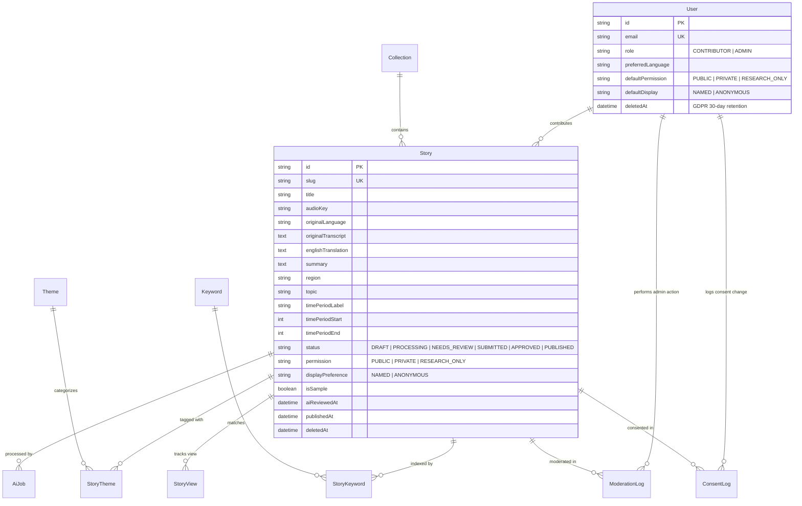

# StoryKeeper AI — Public Digital Archive for Oral Histories & Cultural Memory

> *"Every elder is a library. Let's not lose the books."*

StoryKeeper AI is a public digital repository and ethical cultural preservation platform for oral histories, folk songs, heirloom recipes, vanishing trades, and community memories. It enables families and cultural organizations to record real human voices, uses AI strictly to make those voices searchable, readable, and translated, and enforces human review and explicit contributor consent before any memory becomes public.

---

## 📸 Screenshots & Highlights

```
+---------------------------------------------------------------------------------------+
|  [ LANDING PAGE HERO ]                                                                |
|  "Every elder is a library. Let's not lose the books."                                |
|  - Generative audio waveform canvas & live sample player                             |
|  - Infinite multilingual script marquee (Devanagari, Tamil, Bengali, Gurmukhi...)    |
|  - Real database stats strip: 14+ preserved stories, 8 languages, 6 decades          |
+---------------------------------------------------------------------------------------+
|  [ CONTRIBUTOR STUDIO ]                                                               |
|  - Browser audio recording with 16kHz WAV encoder & AnalyserNode visualizer          |
|  - Autosaved metadata (geography, time period, topic, collection)                    |
|  - Explicit consent control: Public / Private / Research Only · Named / Anonymous     |
+---------------------------------------------------------------------------------------+
|  [ ADMIN CONSOLE & SEARCH ]                                                           |
|  - Trigram + ILIKE weighted search with snippet highlighting for "harvest"            |
|  - Moderation queue with consent pre-flight checks and audit logging                  |
+---------------------------------------------------------------------------------------+
```

---

## 🏛 Architecture Diagram

```mermaid
flowchart TD
    subgraph ClientLayer["Frontend & Client Studio"]
        Browser["Next.js App Router (RSC + Framer Motion)"]
        Recorder["16kHz Client WAV Encoder (AudioContext)"]
        Player["Wavesurfer.js Audio Player"]
    end

    subgraph ServiceLayer["Application & Backend Services"]
        AppServer["Next.js Server Actions & Route Handlers"]
        AuthService["Better Auth (Cookie Sessions & RBAC)"]
        Permissions["Non-negotiable publicStoryWhere() Guard"]
        RateLimiter["Sliding Window Rate Limiter"]
    end

    subgraph ExternalServices["Storage & AI Infrastructure"]
        R2["Cloudflare R2 (S3 Presigned PUT / Signed GET)"]
        OpenRouter["OpenRouter API (openai/whisper & deepseek)"]
        NeonDB["Neon Postgres (Pooled Runtime + Direct Migrations)"]
    end

    Recorder -->|Direct Presigned PUT| R2
    Browser -->|Interactive Queries| AppServer
    Player -->|Signed GET with HMAC / S3 Auth| R2
    AppServer --> AuthService
    AppServer --> Permissions
    AppServer --> RateLimiter
    Permissions -->|Filtered Query| NeonDB
    AppServer -->|Async AI Job with after()| OpenRouter
```

---

## 🧬 Data Model (Entity Relationship Diagram)



---

## ⚖️ Ethics, Privacy & Consent Design

1. **Explicit Permission Required**: No story is public without explicit contributor permission (`PUBLIC`).
2. **Single Filter Helper**: A story is publicly visible *only* if `status = PUBLISHED AND permission = PUBLIC AND deletedAt IS NULL`. This is strictly enforced in `publicStoryWhere()` across every public query.
3. **Signed Audio Streaming**: Audio for non-public stories is never publicly accessible. All audio is served via short-lived signed URLs generated only after authorization.
4. **Contributor Anonymity**: Public pages never expose email addresses, phone numbers, or exact residential addresses. Contributor attribution respects `displayPreference` (`NAMED` or `ANONYMOUS`).
5. **AI Never Invents**: AI is used strictly for speech-to-text, translation, and structured summarization. All AI outputs are labeled `"AI-generated · editable by humans"`, and the original transcript is preserved in a separate column.
6. **Archival Disclaimer**: Every public story carries the disclaimer: *"Stories represent personal memories and community histories, not verified historical facts."*
7. **GDPR Account Deletion**: Contributor account deletion follows a 30-day grace period with choice between complete deletion or anonymous archival donation.

---

## 🤖 AI Processing Pipeline

The AI pipeline is powered exclusively by **OpenRouter**:
1. **Audio Ingestion**: Audio recorded in the browser is client-encoded into 16kHz WAV format (or uploaded as MP3/M4A/WAV/OGG) and pushed directly to Cloudflare R2 via presigned PUT.
2. **Speech-to-Text (`openai/whisper-large-v3`)**: Audio bytes are retrieved server-side, base64-encoded, and transcribed in their native language (preserving Devanagari, Tamil, Bengali, or Arabic scripts).
3. **Structured Translation & Analysis (`deepseek/deepseek-chat` or `anthropic/claude-3.5-sonnet`)**:
   - High-fidelity English translation.
   - Concise 2-sentence archive summary.
   - 3 to 8 cultural and thematic keywords.
   - Historical time period and theme suggestions.
4. **Asynchronous Non-Blocking Execution**: Runs in the background via Next.js `after()`, updating the `AiJob` table while the contributor monitors progress via live polling.
5. **Human Review**: Contributor reviews the side-by-side transcript and translation, can edit any field, and marks it verified before submitting for admin moderation.

---

## 🛠 Tech Stack

- **Framework**: Next.js (App Router, React Server Components, TypeScript strict)
- **Styling**: Tailwind CSS, shadcn/ui, lucide-react
- **Motion**: Framer Motion (`framer-motion`)
- **Database & ORM**: Neon Serverless Postgres + Prisma ORM
- **Authentication**: Better Auth (HTTP-only cookie sessions, RBAC, password reset)
- **AI Provider**: OpenRouter (`/api/v1/audio/transcriptions` & `/api/v1/chat/completions`)
- **Object Storage**: Cloudflare R2 (S3-compatible SDK `@aws-sdk/client-s3`)
- **Audio Processing**: Browser MediaRecorder, 16kHz client WAV encoder, wavesurfer.js
- **Search**: PostgreSQL full-text trigram + multi-field weighted scoring
- **Testing**: Vitest (unit & integration) + Playwright (end-to-end browser journeys)
- **Deployment**: Vercel + Neon + Cloudflare R2

---

## 🚀 Local Development Setup

### 1. Prerequisites
- Node.js 20+ and `pnpm` (`npm install -g pnpm`)
- PostgreSQL instance (or Neon database)

### 2. Clone and Install
```bash
git clone https://github.com/your-username/storykeeper.git
cd storykeeper
pnpm install
```

### 3. Environment Variables
Copy `.env.example` to `.env`:
```bash
cp .env.example .env
```
Ensure you provide:
- `DATABASE_URL` (Postgres connection URL)
- `DIRECT_URL` (Direct Postgres connection URL)
- `BETTER_AUTH_SECRET` (generate via `openssl rand -hex 32`)
- `OPENROUTER_API_KEY` (OpenRouter API key; leave blank to use automatic mock fallback for offline dev)

### 4. Database Setup & Seeding
```bash
pnpm prisma:generate
pnpm prisma:migrate
pnpm prisma:seed
```

### 5. Start Development Server
```bash
pnpm dev
```
Open [http://localhost:3000](http://localhost:3000) in your browser.

---

## 🧪 Testing

```bash
# Run unit & server integration tests (Vitest)
pnpm test

# Run stress-test seeding (120 stories for search scalability)
pnpm seed:stress

# Run end-to-end browser tests (Playwright)
pnpm test:e2e
```

---

## 🗺 Future Roadmap

- **Conversational AI Search**: Ask conversational questions across the archive (e.g. *"What did elders remember about the 1965 monsoon?"*) with cited spoken audio timestamps.
- **Supporting Media**: Allow contributors to attach family photographs, letters, and recipe cards to spoken memories.
- **Multi-chunk Long Audio**: Automatic chunking and multi-speaker diarization for interviews longer than 30 minutes.
- **Expanded Regional Script Fonts**: Automatic native typography loading for Kannada, Malayalam, Odia, and Gurmukhi.
